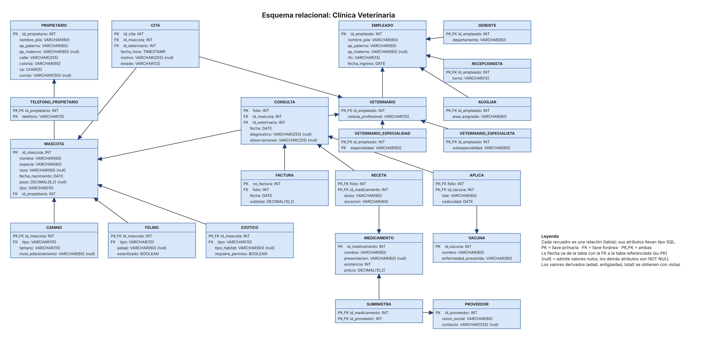

# Unidad 3 · Tarea 3.1: Transformación de modelo E-R a esquema relacional y reglas de integridad

**Materia:** Estructura de Datos
**Alumno:** Ximena Sánchez Lugo
**Docente:** Rubén Miguel Riojas Rodríguez
**Institución:** Instituto Tecnológico Superior de Monclova (ITSM)

## Contenido de la carpeta

| Archivo | Descripción |
|---|---|
| [`Tarea3.1_Esquema_Relacional.pdf`](Tarea3.1_Esquema_Relacional.pdf) | Reporte técnico: componentes formales, restricciones de integridad, reglas de conversión, esquema formal y tabular, diagrama relacional |
| [`esquema_relacional.drawio`](esquema_relacional.drawio) | Diagrama del esquema relacional en formato editable (draw.io / diagrams.net) |
| [`esquema_relacional.png`](esquema_relacional.png) | Diagrama en imagen |
| [`esquema_relacional.pdf`](esquema_relacional.pdf) | Diagrama en PDF vectorial |
| [`esquema_veterinaria.sql`](esquema_veterinaria.sql) | Script SQL (PostgreSQL): dominios, tablas, llaves y vistas |
| [`esquema_relacional_formal.md`](esquema_relacional_formal.md) | Esquema relacional en notación formal |
| [`esquema_tabular.md`](esquema_tabular.md) | Esquema tabular con PK, FK y restricciones |
| [`resumen_llaves_foraneas.md`](resumen_llaves_foraneas.md) | Resumen de llaves foráneas y acciones referenciales |
| [`dominios.md`](dominios.md) | Dominios definidos |
| [`reglas_conversion.md`](reglas_conversion.md) | Reglas de conversión E-R → relacional |

## Video explicativo

[Enlace de YouTube (pendiente de agregar)](https://youtube.com/)

---

## Introducción

El modelo relacional, propuesto por E. F. Codd en 1970, representa la información como relaciones (tablas) y se apoya en la teoría de conjuntos y la lógica de predicados. En esta tarea se investigan sus componentes formales y se transforma el diagrama E-R Extendido de la clínica veterinaria (Unidad 2) en un esquema relacional de 22 relaciones, con sus llaves primarias y foráneas.

## Componentes formales del modelo relacional

- **Dominio:** conjunto de valores atómicos permitidos para un atributo.
- **Atributo:** nombre del papel que juega un dominio en un esquema.
- **Esquema de relación** R(A₁, …, Aₙ): nombre y lista de atributos; *n* es su grado.
- **Relación (instancia):** subconjunto finito de dom(A₁) × … × dom(Aₙ).
- **Tupla:** elemento de la relación; la cardinalidad es el número de tuplas.

| Término formal | Término informal (SQL) | Ejemplo |
|---|---|---|
| Relación | Tabla | MASCOTA |
| Tupla | Fila | (1, 'Rex', 'perro', …) |
| Atributo | Columna | fecha_nacimiento |
| Dominio | Tipo + restricciones | d_peso: DECIMAL(6,2) > 0 |
| Grado | Número de columnas | MASCOTA tiene grado 8 |

**Claves:** superclave, clave candidata, clave primaria, clave alterna y clave foránea.

## Restricciones de integridad

| Restricción | Enunciado | Aplicación en el proyecto |
|---|---|---|
| **De entidad** | La PK no puede ser NULL ni repetirse | PRIMARY KEY en las 22 tablas |
| **Referencial** | Toda FK es NULL o coincide con una PK existente | 22 FOREIGN KEY (ver [resumen](resumen_llaves_foraneas.md)) |
| **De dominio** | Todo valor pertenece al dominio de su atributo | 18 dominios con `CREATE DOMAIN` ([ver](dominios.md)) |

**Acciones referenciales:** `CASCADE` en tablas dependientes (teléfonos, subtipos, receta y aplicación de una consulta) y `RESTRICT` donde se conserva el historial (mascotas, citas, consultas, facturas y catálogos).

## Reglas de conversión aplicadas

| Construcción E-R / E-RE | Regla de conversión | Aplicación en el proyecto |
|---|---|---|
| Entidad fuerte | Una tabla; atributos simples = columnas; identificador = PK | PROPIETARIO, MASCOTA, EMPLEADO, MEDICAMENTO, PROVEEDOR, VACUNA |
| Atributo compuesto | Se incluyen solo sus componentes (aplanado) | nombre → nombre_pila, ap_paterno, ap_materno; dirección → calle, colonia, cp |
| Atributo multivalorado | Tabla aparte con FK al dueño; PK = (FK, valor) | TELEFONO_PROPIETARIO; VETERINARIO_ESPECIALIDAD |
| Atributo derivado | No se almacena; se calcula con una vista | v_mascota.edad, v_empleado.antiguedad, v_factura.total |
| Relación 1:N | La PK del lado 1 se propaga como FK al lado N | Posee: MASCOTA.id_propietario |
| Relación 1:1 | FK con UNIQUE en una de las tablas | Genera: FACTURA.folio UNIQUE → CONSULTA |
| Relación N:M | Tabla propia con las PK de ambas entidades como FK y los atributos de la relación | SUMINISTRA, CITA (Agenda), CONSULTA (Atiende), RECETA, APLICA |
| Especialización disjunta | Tabla por subtipo (PK = FK) con discriminador | CANINO, FELINO, EXOTICO con MASCOTA.tipo |
| Especialización solapada | Tabla por rol sin discriminador exclusivo | VETERINARIO, GERENTE, RECEPCIONISTA, AUXILIAR |
| Jerarquía multinivel | Cadena de FK entre niveles | EMPLEADO ← VETERINARIO ← VETERINARIO_ESPECIALISTA |
| Agregación | La relación agregada se vuelve tabla con PK propia, que las demás relaciones referencian | CONSULTA(folio) referenciada por RECETA, APLICA y FACTURA |

## Diagrama del esquema relacional

## Esquema relacional formal

**PROPIETARIO**(__id_propietario__, nombre_pila, ap_paterno, ap_materno, calle, colonia, cp, correo)  
- PK: (id_propietario)
- UNIQUE: (correo)

**TELEFONO_PROPIETARIO**(__id_propietario__, __telefono__)  
- PK: (id_propietario, telefono)
- FK: (id_propietario) → PROPIETARIO(id_propietario) · ON DELETE CASCADE

**MASCOTA**(__id_mascota__, nombre, especie, raza, fecha_nacimiento, peso, tipo, *id_propietario*)  
- PK: (id_mascota)
- FK: (id_propietario) → PROPIETARIO(id_propietario) · ON DELETE RESTRICT
- UNIQUE: (id_mascota, tipo)

**CANINO**(__id_mascota__, *tipo*, tamano, nivel_adiestramiento)  
- PK: (id_mascota)
- FK: (id_mascota, tipo) → MASCOTA(id_mascota, tipo) · ON DELETE CASCADE

**FELINO**(__id_mascota__, *tipo*, pelaje, esterilizado)  
- PK: (id_mascota)
- FK: (id_mascota, tipo) → MASCOTA(id_mascota, tipo) · ON DELETE CASCADE

**EXOTICO**(__id_mascota__, *tipo*, tipo_habitat, requiere_permiso)  
- PK: (id_mascota)
- FK: (id_mascota, tipo) → MASCOTA(id_mascota, tipo) · ON DELETE CASCADE

**EMPLEADO**(__id_empleado__, nombre_pila, ap_paterno, ap_materno, rfc, fecha_ingreso)  
- PK: (id_empleado)
- UNIQUE: (rfc)

**VETERINARIO**(__id_empleado__, cedula_profesional)  
- PK: (id_empleado)
- FK: (id_empleado) → EMPLEADO(id_empleado) · ON DELETE CASCADE
- UNIQUE: (cedula_profesional)

**VETERINARIO_ESPECIALIDAD**(__id_empleado__, __especialidad__)  
- PK: (id_empleado, especialidad)
- FK: (id_empleado) → VETERINARIO(id_empleado) · ON DELETE CASCADE

**VETERINARIO_ESPECIALISTA**(__id_empleado__, subespecialidad)  
- PK: (id_empleado)
- FK: (id_empleado) → VETERINARIO(id_empleado) · ON DELETE CASCADE

**GERENTE**(__id_empleado__, departamento)  
- PK: (id_empleado)
- FK: (id_empleado) → EMPLEADO(id_empleado) · ON DELETE CASCADE

**RECEPCIONISTA**(__id_empleado__, turno)  
- PK: (id_empleado)
- FK: (id_empleado) → EMPLEADO(id_empleado) · ON DELETE CASCADE

**AUXILIAR**(__id_empleado__, area_asignada)  
- PK: (id_empleado)
- FK: (id_empleado) → EMPLEADO(id_empleado) · ON DELETE CASCADE

**CITA**(__id_cita__, *id_mascota*, *id_veterinario*, fecha_hora, motivo, estado)  
- PK: (id_cita)
- FK: (id_mascota) → MASCOTA(id_mascota) · ON DELETE RESTRICT
- FK: (id_veterinario) → VETERINARIO(id_empleado) · ON DELETE RESTRICT
- UNIQUE: (id_veterinario, fecha_hora)

**CONSULTA**(__folio__, *id_mascota*, *id_veterinario*, fecha, diagnostico, observaciones)  
- PK: (folio)
- FK: (id_mascota) → MASCOTA(id_mascota) · ON DELETE RESTRICT
- FK: (id_veterinario) → VETERINARIO(id_empleado) · ON DELETE RESTRICT

**MEDICAMENTO**(__id_medicamento__, nombre, presentacion, existencia, precio)  
- PK: (id_medicamento)

**PROVEEDOR**(__id_proveedor__, razon_social, contacto)  
- PK: (id_proveedor)

**VACUNA**(__id_vacuna__, nombre, enfermedad_prevenida)  
- PK: (id_vacuna)

**RECETA**(__folio__, __id_medicamento__, dosis, duracion)  
- PK: (folio, id_medicamento)
- FK: (folio) → CONSULTA(folio) · ON DELETE CASCADE
- FK: (id_medicamento) → MEDICAMENTO(id_medicamento) · ON DELETE RESTRICT

**APLICA**(__folio__, __id_vacuna__, lote, caducidad)  
- PK: (folio, id_vacuna)
- FK: (folio) → CONSULTA(folio) · ON DELETE CASCADE
- FK: (id_vacuna) → VACUNA(id_vacuna) · ON DELETE RESTRICT

**SUMINISTRA**(__id_medicamento__, __id_proveedor__)  
- PK: (id_medicamento, id_proveedor)
- FK: (id_medicamento) → MEDICAMENTO(id_medicamento) · ON DELETE CASCADE
- FK: (id_proveedor) → PROVEEDOR(id_proveedor) · ON DELETE RESTRICT

**FACTURA**(__no_factura__, *folio*, fecha, subtotal)  
- PK: (no_factura)
- FK: (folio) → CONSULTA(folio) · ON DELETE RESTRICT
- UNIQUE: (folio)

## Resumen de llaves foráneas

| # | Tabla hija | FK | Tabla padre | ON DELETE |
|---|---|---|---|---|
| 1 | TELEFONO_PROPIETARIO | id_propietario | PROPIETARIO(id_propietario) | CASCADE |
| 2 | MASCOTA | id_propietario | PROPIETARIO(id_propietario) | RESTRICT |
| 3 | CANINO | id_mascota, tipo | MASCOTA(id_mascota, tipo) | CASCADE |
| 4 | FELINO | id_mascota, tipo | MASCOTA(id_mascota, tipo) | CASCADE |
| 5 | EXOTICO | id_mascota, tipo | MASCOTA(id_mascota, tipo) | CASCADE |
| 6 | VETERINARIO | id_empleado | EMPLEADO(id_empleado) | CASCADE |
| 7 | VETERINARIO_ESPECIALIDAD | id_empleado | VETERINARIO(id_empleado) | CASCADE |
| 8 | VETERINARIO_ESPECIALISTA | id_empleado | VETERINARIO(id_empleado) | CASCADE |
| 9 | GERENTE | id_empleado | EMPLEADO(id_empleado) | CASCADE |
| 10 | RECEPCIONISTA | id_empleado | EMPLEADO(id_empleado) | CASCADE |
| 11 | AUXILIAR | id_empleado | EMPLEADO(id_empleado) | CASCADE |
| 12 | CITA | id_mascota | MASCOTA(id_mascota) | RESTRICT |
| 13 | CITA | id_veterinario | VETERINARIO(id_empleado) | RESTRICT |
| 14 | CONSULTA | id_mascota | MASCOTA(id_mascota) | RESTRICT |
| 15 | CONSULTA | id_veterinario | VETERINARIO(id_empleado) | RESTRICT |
| 16 | RECETA | folio | CONSULTA(folio) | CASCADE |
| 17 | RECETA | id_medicamento | MEDICAMENTO(id_medicamento) | RESTRICT |
| 18 | APLICA | folio | CONSULTA(folio) | CASCADE |
| 19 | APLICA | id_vacuna | VACUNA(id_vacuna) | RESTRICT |
| 20 | SUMINISTRA | id_medicamento | MEDICAMENTO(id_medicamento) | CASCADE |
| 21 | SUMINISTRA | id_proveedor | PROVEEDOR(id_proveedor) | RESTRICT |
| 22 | FACTURA | folio | CONSULTA(folio) | RESTRICT |

El esquema tabular completo (tipos, dominios y restricciones por atributo) está en [`esquema_tabular.md`](esquema_tabular.md) y el script ejecutable en [`esquema_veterinaria.sql`](esquema_veterinaria.sql).

## Decisiones de diseño

- **Mascota (disjunta):** tabla por subtipo con discriminador `tipo` y FK compuesta (id_mascota, tipo); así una mascota no puede estar en dos subtipos.
- **Empleado (solapada):** tabla por rol sin discriminador; un veterinario puede ser también gerente.
- **Agregación:** CONSULTA (relación Atiende) tiene PK propia (`folio`) que RECETA, APLICA y FACTURA referencian.
- **Genera (1:1):** FK única en FACTURA hacia CONSULTA.
- **Derivados:** edad, antigüedad y total se obtienen con vistas.
- **Participaciones totales** no expresables con PK/FK (especialización total, Medicamento–Proveedor, Consulta–Factura): disparadores diferidos.

## Conclusión

La transformación produjo 22 relaciones, 22 llaves foráneas y 18 dominios. Las restricciones de entidad, referencial y de dominio garantizan la consistencia de la información, y las que el modelo no expresa por sí solo se documentan con vistas y disparadores. El esquema queda listo para normalizarse e implementarse en un SGBD.

## Referencias bibliográficas (APA)

- Codd, E. F. (1970). A relational model of data for large shared data banks. *Communications of the ACM, 13*(6), 377-387.
- Coronel, C., & Morris, S. (2019). *Database systems: Design, implementation, & management* (13th ed.). Cengage Learning.
- Date, C. J. (2003). *An introduction to database systems* (8th ed.). Addison-Wesley.
- Elmasri, R., & Navathe, S. B. (2015). *Fundamentals of database systems* (7th ed.). Pearson.
- Silberschatz, A., Korth, H. F., & Sudarshan, S. (2020). *Database system concepts* (7th ed.). McGraw-Hill Education.
