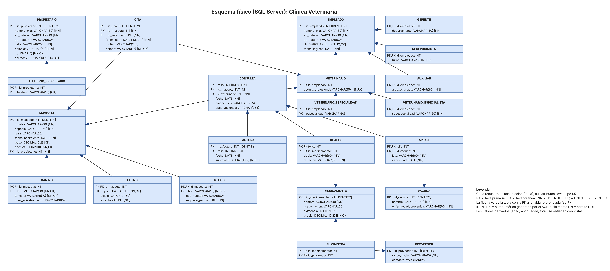

# Unidad 3 · Tarea 3.2: Esquema físico del modelo relacional (DDL)

**Materia:** Estructura de Datos
**Alumno:** Ximena Sánchez Lugo
**Docente:** Rubén Miguel Riojas Rodríguez
**Institución:** Instituto Tecnológico Superior de Monclova (ITSM)

**SGBD:** Microsoft SQL Server 2025 · **Herramienta:** SQL Server Management Studio (SSMS) 22

## Contenido de la carpeta

| Archivo | Descripción |
|---|---|
| [`Tarea3.2_Esquema_Fisico.pdf`](Tarea3.2_Esquema_Fisico.pdf) | Reporte técnico: diccionario de datos, diagrama físico, validación y evidencias |
| [`scripts/01_ddl_veterinaria.sql`](scripts/01_ddl_veterinaria.sql) | Script DDL (T-SQL): base de datos, CREATE TABLE, PK, FK con ON UPDATE/DELETE, CHECK, NOT NULL, UNIQUE, índices, vistas y descripciones |
| [`scripts/02_datos_prueba.sql`](scripts/02_datos_prueba.sql) | Datos de prueba |
| [`scripts/03_pruebas_integridad.sql`](scripts/03_pruebas_integridad.sql) | 21 pruebas de integridad (TRY…CATCH con mensajes PRINT) |
| [`scripts/04_diccionario_datos.sql`](scripts/04_diccionario_datos.sql) | Consultas al catálogo (sys.*) que extraen el diccionario de datos |
| [`diccionario_datos.md`](diccionario_datos.md) | Diccionario de datos de las 22 tablas |
| [`esquema_fisico.drawio`](esquema_fisico.drawio) / [`.png`](esquema_fisico.png) / [`.pdf`](esquema_fisico.pdf) | Diagrama del esquema físico |
| [`INSTRUCCIONES_EJECUCION.md`](INSTRUCCIONES_EJECUCION.md) | Guía para ejecutar los scripts en SSMS y tomar las evidencias |
| [`evidencias/`](evidencias/) | Capturas de ejecución en SQL Server |

## Orden de ejecución

1. `01_ddl_veterinaria.sql` (crea la base `veterinaria`; reejecutable)
2. `02_datos_prueba.sql`
3. `03_pruebas_integridad.sql`
4. `04_diccionario_datos.sql`

## Diagrama del esquema físico

## Resumen

- 22 tablas, 3 vistas, 22 PRIMARY KEY, 22 FOREIGN KEY (3 compuestas), restricciones UNIQUE y CHECK nombradas, e índices sobre las FK.
- Todas las FK usan `ON UPDATE CASCADE`; `ON DELETE CASCADE` en tablas dependientes y `NO ACTION` donde se conserva el historial.
- Llaves sustitutas con `IDENTITY(1,1)`.
- `propietario.correo` (opcional y único) usa un índice único filtrado, porque un UNIQUE de SQL Server solo admite un NULL.
