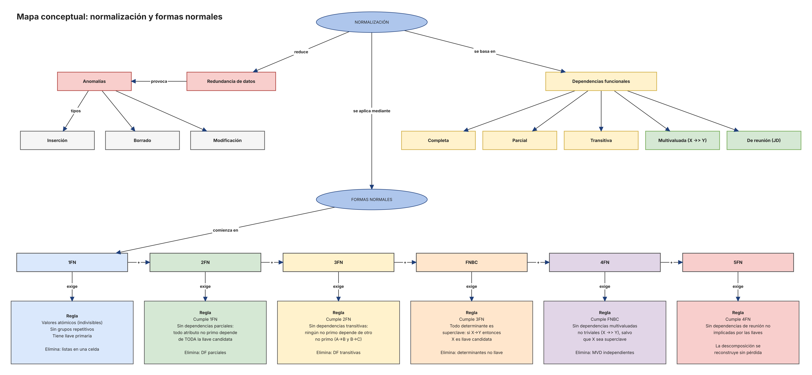

# Unidad 4 · Tarea 4.1: Fundamentos de dependencias y mapa conceptual de formas normales

**Materia:** Estructura de Datos
**Alumno:** Ximena Sánchez Lugo
**Docente:** Rubén Miguel Riojas Rodríguez
**Institución:** Instituto Tecnológico Superior de Monclova (ITSM)

## Contenido de la carpeta

| Archivo | Descripción |
|---|---|
| [`Tarea4.1_Dependencias_Formas_Normales.pdf`](Tarea4.1_Dependencias_Formas_Normales.pdf) | Documento con el mapa conceptual y el desarrollo teórico de cada forma normal con ejemplos |
| [`mapa_conceptual.drawio`](mapa_conceptual.drawio) | Mapa conceptual en formato editable (draw.io / diagrams.net) |
| [`mapa_conceptual.png`](mapa_conceptual.png) / [`.pdf`](mapa_conceptual.pdf) | Exportaciones del mapa conceptual |
| [`formas_normales.md`](formas_normales.md) | Tabla resumen de las formas normales |

## Mapa conceptual

## Concepto formal de normalización

Proceso de **descomposición** de un esquema de relación R en esquemas más pequeños que cumplen una forma normal, con dos propiedades: **reunión sin pérdida** (el JOIN de las partes reproduce R) y **preservación de dependencias**. Sus objetivos son reducir la redundancia, evitar anomalías y guardar cada hecho en un solo lugar.

## Dependencias

- **Funcional X → Y:** dos tuplas con el mismo X tienen el mismo Y (ej. `id_medicamento → nombre, precio`).
- **Completa / parcial:** completa si Y no depende de ningún subconjunto propio de X; parcial si algún subconjunto propio ya determina Y.
- **Transitiva:** A → B y B → C implican A → C a través de B (ej. `id_mascota → id_propietario → nombre_propietario`).
- **Multivaluada X ↠ Y:** dos hechos multivaluados independientes en la misma relación (origen de la 4FN).
- **De reunión (JD):** la relación equivale a la reunión de sus proyecciones (origen de la 5FN).
- **Axiomas de Armstrong:** reflexividad, aumentación y transitividad.

## Anomalías

| Anomalía | Descripción | Ejemplo |
|---|---|---|
| De inserción | No se puede registrar un hecho sin otro | Dar de alta un medicamento exige inventar un folio de consulta |
| De borrado | Al eliminar un hecho se pierde otro | Borrar la única receta de un medicamento borra su nombre y precio |
| De modificación | Un dato repetido debe cambiarse en muchas filas | Cambiar el precio del Meloxicam en todas sus filas |

## Formas normales

| Forma normal | Condición | Elimina | Descomposición típica |
|---|---|---|---|
| **1FN** | Atributos atómicos, sin grupos repetitivos, con llave primaria | Listas y grupos repetitivos | Nueva tabla por cada grupo |
| **2FN** | 1FN + todo atributo no primo depende de **toda** la llave | Dependencias parciales | Separar por cada parte de la llave |
| **3FN** | 2FN + sin dependencias transitivas | Dependencias transitivas | Separar la entidad determinada |
| **FNBC** | Todo determinante es superclave | Determinantes que no son llave | Separar determinante y dependiente |
| **4FN** | FNBC + sin dependencias multivaluadas no triviales | MVD independientes | Una relación por cada hecho multivaluado |
| **5FN** | 4FN + sin dependencias de reunión no implicadas por las llaves | Dependencias de reunión | Proyecciones reunibles sin pérdida |

Los ejemplos de cada forma normal (propietario y teléfonos, receta, mascota y propietario, atención y especialidad, especialidades e idiomas, suministro) están desarrollados en el PDF.

## Referencias bibliográficas (APA)

- Codd, E. F. (1970). A relational model of data for large shared data banks. *Communications of the ACM, 13*(6), 377-387.
- Codd, E. F. (1972). Further normalization of the data base relational model. En R. Rustin (Ed.), *Data base systems* (pp. 33-64). Prentice-Hall.
- Coronel, C., & Morris, S. (2019). *Database systems: Design, implementation, & management* (13th ed.). Cengage Learning.
- Date, C. J. (2003). *An introduction to database systems* (8th ed.). Addison-Wesley.
- Elmasri, R., & Navathe, S. B. (2015). *Fundamentals of database systems* (7th ed.). Pearson.
- Fagin, R. (1977). Multivalued dependencies and a new normal form for relational databases. *ACM Transactions on Database Systems, 2*(3), 262-278.
- Fagin, R. (1979). Normal forms and relational database operators. *Proceedings of the ACM SIGMOD International Conference on Management of Data*, 153-160.
- Silberschatz, A., Korth, H. F., & Sudarshan, S. (2020). *Database system concepts* (7th ed.). McGraw-Hill Education.
