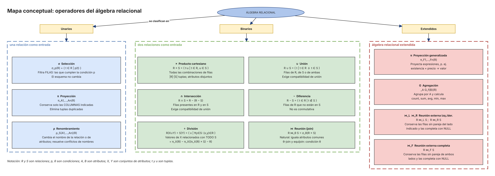

# Unidad 5 · Tarea 5.1: Operadores fundamentales y extendidos del álgebra relacional

**Materia:** Estructura de Datos
**Alumno:** Ximena Sánchez Lugo
**Docente:** Rubén Miguel Riojas Rodríguez
**Institución:** Instituto Tecnológico Superior de Monclova (ITSM)

## Contenido de la carpeta

| Archivo | Descripción |
|---|---|
| [`Tarea5.1_Operadores_Algebra_Relacional.pdf`](Tarea5.1_Operadores_Algebra_Relacional.pdf) | Marco conceptual, notación formal y ejemplos |
| [`mapa_algebra.drawio`](mapa_algebra.drawio) | Mapa conceptual editable (draw.io / diagrams.net) |
| [`mapa_algebra.png`](mapa_algebra.png) / [`.pdf`](mapa_algebra.pdf) | Exportaciones del mapa conceptual |
| [`operadores.md`](operadores.md) | Tabla resumen de operadores |

## Mapa conceptual

## Operadores

| Operador | Símbolo | Aridad | Definición formal | SQL |
|---|---|---|---|---|
| Selección | σ | Unario | σ_p(R) = { t ∈ R \| p(t) } | WHERE |
| Proyección | π | Unario | π_A(R) = { t[A] \| t ∈ R } | SELECT DISTINCT |
| Renombramiento | ρ | Unario | ρ_S(B1…Bn)(R) | AS |
| Producto cartesiano | × | Binario | R × S = { t·u \| t ∈ R, u ∈ S } | CROSS JOIN |
| Unión | ∪ | Binario | R ∪ S = { t \| t ∈ R ∨ t ∈ S } | UNION |
| Intersección | ∩ | Binario | R ∩ S = R − (R − S) | INTERSECT |
| Diferencia | − | Binario | R − S = { t ∈ R \| t ∉ S } | EXCEPT |
| División | ÷ | Binario | R(X∪Y) ÷ S(Y) = { x \| ∀y ∈ S: (x,y) ∈ R } | NOT EXISTS doble |
| Reunión | ⋈ | Binario | R ⋈_θ S = σ_θ(R × S) | JOIN … ON |
| Proyección generalizada | π_F | Unario | π con expresiones aritméticas | SELECT expr AS alias |
| Agregación | G | Unario | _A G_f(B)(R) | GROUP BY |
| Reunión externa | ⋈_L ⋈_R ⋈_F | Binario | (R ⋈ S) ∪ tuplas sin pareja con NULL | LEFT / RIGHT / FULL JOIN |

## Notación y ejemplos

- **Selección:** `σ_precio>100(medicamento)` filtra filas.
- **Proyección:** `π_tipo(mascota)` conserva columnas y elimina duplicados.
- **Reunión natural:** `mascota ⋈ propietario` iguala los atributos comunes (`id_propietario`).
- **División:** `suministra ÷ π_id_proveedor(proveedor)` obtiene los medicamentos surtidos por *todos* los proveedores.
- **Agregación:** `_id_veterinario G_count(folio)→num_consultas(consulta)`.
- **Reunión externa izquierda:** `mascota ⋈_L consulta` conserva las mascotas sin consulta con folio NULL.

Los ejemplos completos con sus resultados están en el PDF.

## Referencias bibliográficas (APA)

- Codd, E. F. (1970). A relational model of data for large shared data banks. *Communications of the ACM, 13*(6), 377-387.
- Elmasri, R., & Navathe, S. B. (2015). *Fundamentals of database systems* (7th ed.). Pearson.
- Garcia-Molina, H., Ullman, J. D., & Widom, J. (2009). *Database systems: The complete book* (2nd ed.). Pearson.
- Silberschatz, A., Korth, H. F., & Sudarshan, S. (2020). *Database system concepts* (7th ed.). McGraw-Hill Education.
